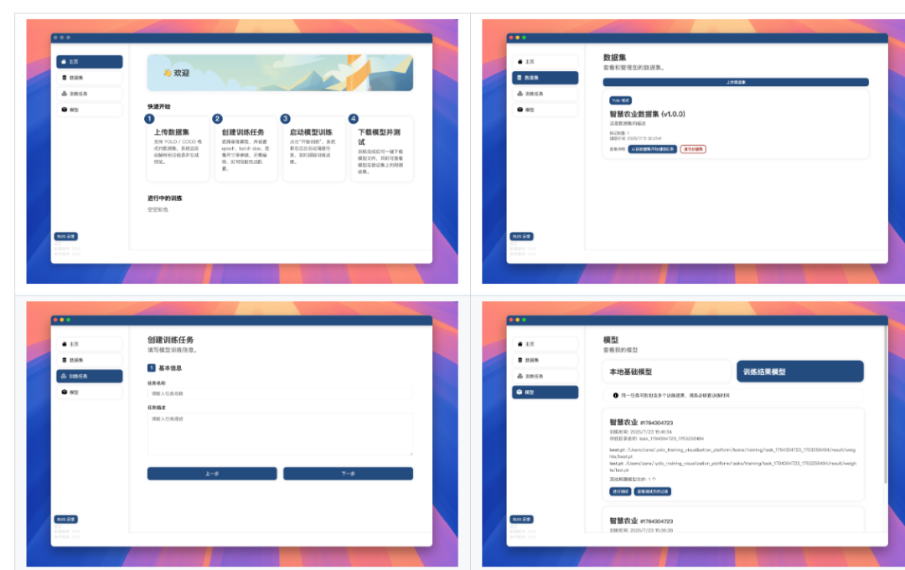
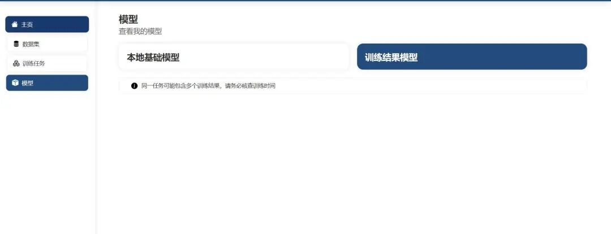

# YOLOv11 Visualization Training Tool: Trains without writing code.

A cross-platform YOLO model training visualization tool based on Electron + Flask, supporting dataset upload, model training.

A cross-platform YOLO model training visualization tool based on Electron + Flask, supporting dataset upload, model training, training progress monitoring, model testing and result visualization, aims to reduce the entry barrier for visual learning detection tasks.

## Function

-

The page is simple, quick to learn.

-

Supports data in multiple formats such as YOLO and COCO.

-

Visualization settings for training parameters (epoch, batch size, image size, etc.)

-

Supports the selection of a base model for transfer learning.

-

Visualize training logs, loss changes, mAP, and other key metrics.

-

Supports multitask parallel training.

-

Supports uploading image paths for single-image inference testing.

-

Runs entirely locally, without relying on cloud platforms.

Installation steps:

Installation Guide
After the download is complete, start HelperComponents first, then launch YoloTrainingVisualizationApp (it may take 1-2 minutes for HelperComponents to load; during this time, prompts indicating that the assistant component cannot be recognized are normal).

Usage Steps:

Upload the dataset, and follow the prompts to upload the dataset in the specified format.

Warm Reminder: Support for CUDA and CPU training, all of which can be configured in the interface.

## Payment

Here is a pay link on Stripe ( https://buy.stripe.com/3cs8yP7sY87d0vu9AB ). Please contact me lonlonago@foxmail.com after funding $89, and I will send you a complete data files , thank you!

